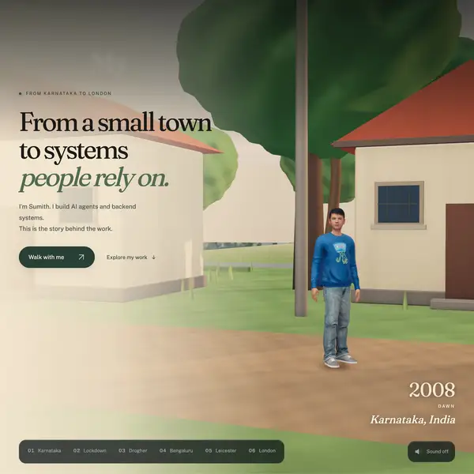

# Sumith Bhandari, portfolio

Source for https://sumithsb.com/, a one-page static site built with [Astro](https://astro.build).

<p align="center">
  <a href="https://sumithsb.com/"></a>
</p>

## Run it

```sh
npm ci
npm run dev       # http://localhost:4321/
npm run build     # static output in dist/
npm run preview   # serve dist/ locally
npm run typecheck # strict TypeScript checks
npm test          # locomotion, travel, rig stance and skin-weight checks
```

Node 20 or newer. The deploy workflow uses Node 22.

In a cloud sandbox, prefix Astro commands with `ASTRO_TELEMETRY_DISABLED=1` if the home configuration directory is unavailable. Use `npm run dev -- --host 0.0.0.0` to bind the development server outside loopback.

## The walk

The opening has six scroll-driven chapters, with separate portrait framing, signed locomotion, a walking-speed limit and scene cuts for large jumps. Captions have expandable detail; the primary navigation and “Skip to the work” link provide direct access to projects. Chapter controls and the story entry link move keyboard focus to the selected heading.

He is aware of the viewer (`src/scripts/walk/presence.ts`): when you stop he meets your eye or follows your pointer, blinks, breathes and lifts his brows on eye contact; he waves once on arrival, turns round rather than walking backwards, and carries each chapter's prop (an umbrella in the rain is held by two-bone IK). All of it is layered over the motion-captured clips in world space after the mixer runs, and is off under reduced motion.

The scene becomes visible after the first character is built and rendered. Reduced motion, missing WebGL, a failed character worker, or context loss use the readable chapter layout. Sound is opt-in and fades out when the story or browser tab is hidden.

The sun's height and direction are set per chapter so the character, trees and buildings cast shadows on the ground. Left and right arrow keys step between chapters and 1 to 6 jump to one. When nothing is happening the scene renders at about 30 frames a second.

`?quality=0`, `?quality=1`, and `?quality=2` select plain rendering, bloom/grade, and ambient occlusion respectively. Mobile starts with plain rendering; desktop starts with bloom/grade and can reduce quality if frames are slow. The plain tier does not allocate postprocessing targets. The sky and the street sets are drawn in the page. The person is a local glTF in `public/people/` (Microsoft Rocketbox, MIT; see `public/people/LICENSE.txt`). A sculpted figure stands in only when that avatar is missing. Each chapter's far panorama is a file in `public/backdrops/`. Ambient sound is synthesized in the browser. The walk does not request images, models or audio from another origin.

For visual verification, check the opening, all six chapter controls, expandable captions and the final continuation link at desktop and portrait sizes, plus keyboard navigation, reduced motion and worker failure. Hardware frame rates should be measured on physical devices rather than software WebGL.

## Where things live

- `src/pages/index.astro`: page sections, plus the work, study and project copy
- `src/data/story.ts`: the six chapter texts, shared by the 3D walk and the plain layout
- `src/layouts/Base.astro`: head, meta tags, Open Graph and JSON-LD
- `src/styles/global.css`: the only stylesheet
- `src/scripts/site.ts`: navigation, reveals and interactions ([Motion](https://motion.dev)); motion is skipped under reduced motion and the page reads fine without JavaScript
- `src/scripts/walk/`: signed locomotion, lighting and the six scenes
- `public/people/`: character model, motion clips and textures
- `public/backdrops/`: one panorama per chapter
- `public/media/`: Claude Anchor demo video and screenshots, Brainvault logo
- `public/fonts/`: Fraunces and Public Sans (latin subsets, SIL OFL)
- `tests/locomotion.test.mjs`: the checks `npm test` runs

The CV links appear automatically once `public/Sumith_Bhandari_CV.pdf` exists.

## Deploy

Every push to `main` runs `.github/workflows/deploy-pages.yml`: it installs, builds, typechecks, runs the tests, then publishes `dist/` to the `pages` branch, which GitHub Pages serves at sumithsb.com.
